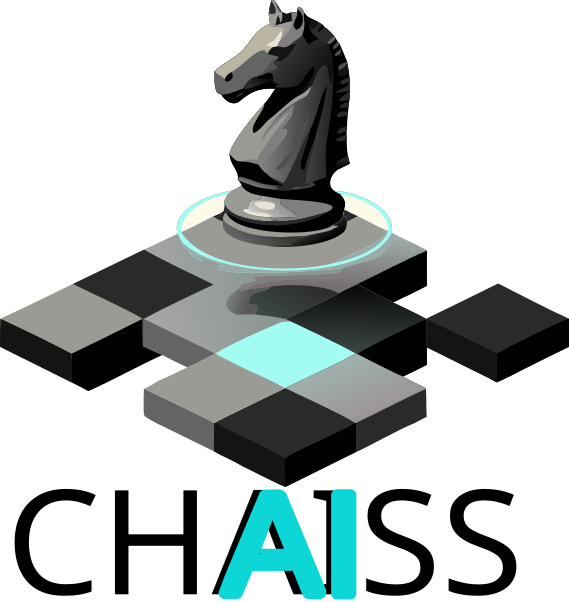
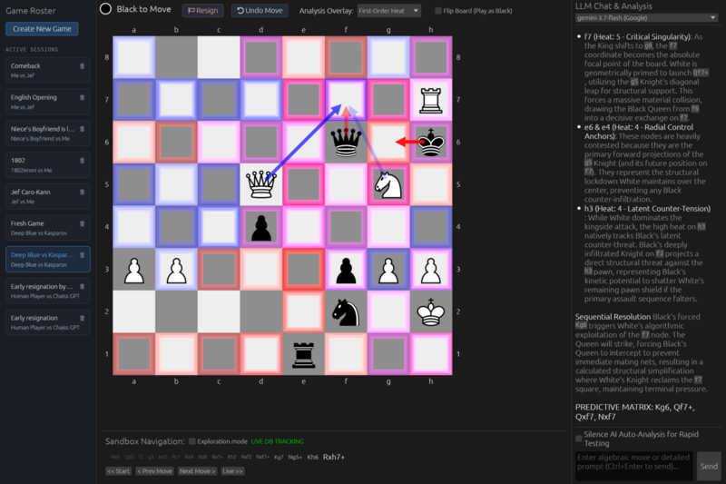

<p align="center">
  
</p>


# Chaiss

**Chaiss** is an intelligent, AI-assisted chessboard application built from the ground up in Rust using the modern `egui` immediate mode UI framework. Designed both for learning and deep exploration of chess, Chaiss integrates tightly with frontier Large Language Models (LLMs) to provide real-time guidance, context-aware analysis, and an environment to experiment with different lines.

## Motivation

This project was born out of two distinct drivers:
1. **The Vibe Coding Experiment:** A desire to experiment working in a "vibe coding" fashion, efficiently juggling multiple projects at once.
2. **The Chess Match Reality Check:** I found myself spending far too much time consulting Gemini for my next best move against my niece's boyfriend, only to realize that LLMs (both Gemini, and ChatGPT even more so) suffered from terrible inherent board vision and memory limitations.

Within mere hours of spelling out that I wanted to use my favorite language, my favorite UI framework within that language, and my favorite crate for interacting with LLMs, I had a working prototype. Chaiss significantly improved my moves simply by being able to persistently and accurately present the true current board state to the LLM backend!

## Key Features

- **Heat Map Overlays:** Coloured rings on every square show which pieces attack it, blue for White and red for Black, growing stronger with each additional attacker. The *First-Order Heat* overlay shows the position as it stands; *Predictive Matrix* sums the attacks over every legal reply, so the squares that matter one move ahead light up.
- **LLM Integration:** Analyse games with Google, OpenAI, Anthropic or Ollama models directly in the app, switching model per game from the chat pane. Every request carries the exact position (FEN, board diagram, move list and chat history), and each reply ends in a predicted continuation that Chaiss draws as arrows on the board. Built on the `llm` crate.
- **Game & Player Persistence:** Name your players and your games. Moves, chat history, board orientation and the model last used are saved to SQLite with `sqlx` as you go, and resume with one click.
- **Dual Control Schemes:** Move pieces with the mouse, or type standard algebraic notation (`Nf3`, `O-O`, `Bxf7+`) into the chat box. Paste a PGN to replay a whole game.
- **Exploration Mode:** Step back through the game and try what-if lines on the board without touching the saved game, then return to the live position in one click.

## Project Structure

- `chaiss-core/` - Rust source code for backend logic, database integrations (`sqlx`), and models.
- `chaiss/` - Rust source code for the `egui`-based frontend application. Includes UI components and an `assets/` directory.
- `docs/` - Requirements, design documents, and developer journals.
- `tools/` - Sandbox and helper scripts for repository maintenance.

## Getting Started

1. **Clone the repository:**
   ```bash
   git clone <repository-url>
   cd chaiss
   ```
2. **Environment Configuration:**
   Copy the provided `.env.example` to `.env` and fill in your desired backend, model, and API keys.
   ```bash
   cp .env.example .env
   ```
   Alternatively (or additionally), use the literate [cola](https://crates.io/crates/colap) configuration: copy `.chaiss.cola.example` to `.chaiss.cola` and edit it — it is a markdown document whose fenced `cola` block *is* the configuration, and it takes precedence over `.env` per key, the database location (`database.url`) included. Every provider with a configured API key is offered in the chat pane's model dropdown, which appears once more than one provider is configured; Ollama needs no key and is offered when it is the configured backend.
   ```bash
   cp .chaiss.cola.example .chaiss.cola
   ```
3. **Run Locally:**
   Thanks to the pre-processed `sqlx` cache and auto-executing built-in Rust migrations, the application can be built and initialized purely offline and is 100% cross-platform. Just run:
   ```bash
   cargo run --release
   ```
   **Developer note:** when `DATABASE_URL` is set (it is, once you copied `.env.example`), the `sqlx::query!` macros validate every query against that live file *at compile time*, while the migrations only run when the app starts. A fresh clone with an un-migrated `chaiss.db` therefore fails to build with `no such column: ...`. Either apply the migrations once with `sqlx migrate run --source chaiss-core/migrations` (needs `cargo install sqlx-cli`), or build with `SQLX_OFFLINE=true` so the committed `chaiss-core/.sqlx` cache is used instead. `.chaiss.cola` can name the file the running app opens (`database.url`), but it cannot reach the build-time check or set `SQLX_OFFLINE`, so a cola-only setup without `.env` is unaffected and builds against the cache automatically.

## Desktop integration (the window icon on Wayland)

On a Wayland session (the default on Ubuntu 26.04 with either KDE Plasma or GNOME), the compositor does not take the window icon from the application; it looks up the desktop entry whose id matches the window's app id and uses that entry's icon. Without one, Plasma shows its generic Wayland icon (a white W on yellow) and GNOME a blank one. Chaiss sets the app id `chaiss`, and installs the matching entry and icon on request:

```bash
cd /path/to/your/chess/directory   # where .env, .chaiss.cola and chaiss.db live
chaiss --install-desktop-entry
```

That writes `~/.local/share/applications/chaiss.desktop` (pointing at this binary, with that directory as the working directory) and `~/.local/share/icons/hicolor/scalable/apps/chaiss.svg`. Run it once per binary location; `cargo install` upgrades keep the path, so no re-run is needed. The flag is Linux-only and refuses to run elsewhere: on X11, Windows and macOS the embedded icon continues to work without the entry, set natively by eframe. winit 0.30 drops window icons on Wayland; winit 0.31 (in beta) implements the `xdg-toplevel-icon` protocol, which Plasma 6.3+ supports, so once eframe moves to it the embedded icon will reach Plasma directly, while GNOME still needs the desktop entry.

## User Guide

<p align="center">
  <a href="docs/user_guide.md"></a>
</p>

The **[Chaiss User Guide](docs/user_guide.md)** walks through the interface shown above: creating and resuming games, loading a PGN, moving by mouse or by notation, the heat map and predictive matrix overlays, talking to the model and reading its predicted arrows, and exploring what-if lines without touching the saved game.

## UI Inspection via MCP

Chaiss is built on `egui` 0.36, which ships an **inspection protocol**
(`egui_inspection`) that exposes a running app's live UI (AccessKit) tree over a
local port. Chaiss wires this to the [`egui-mcp`](https://github.com/rerun-io/kittest_inspector)
server so an AI agent — e.g. Claude Code — can **read and drive the running UI**
through the Model Context Protocol.

**One-time setup** (installs the `egui-mcp` server binary; macOS and Ubuntu/Debian
today, Windows planned):

```bash
tools/scripts/setup-egui-mcp.sh          # add --global to also register at Claude user scope
```

The repository's committed `.mcp.json` registers the `egui` server for Claude
Code automatically once the binary is on your `PATH` (via `~/.cargo/bin`).

**Run Chaiss with inspection enabled** (exposes the UI on `127.0.0.1:5719`):

```bash
tools/scripts/run-chaiss-inspect.sh
# equivalent to:
EGUI_INSPECTION=1 cargo run -p chaiss --features inspection
```

Inspection is a build-time opt-in (the `inspection` feature on `chaiss`, which
enables `eframe/inspection`); normal and release builds are unaffected. With the
app running, the `egui` MCP tools in Claude can connect and interact with it.

> **macOS note:** keep the Chaiss window **foregrounded and visible** while using
> the MCP tools. An occluded or minimized window stops painting, so the AccessKit
> tree collapses to a minimal snapshot and `screenshot` times out ("the app is
> not painting; bring its window to the foreground"). Bring the window to the
> front and the full widget tree and screenshots work.

## Development and Contributions

For a detailed breakdown of the features, architectural choices, and upcoming roadmap, please refer to the `docs/requirements/chaiss_requirements.md` file.

## Acknowledgments

- Thanks to **Emil Ernerfeldt** (@emilk) and contributors for the [`egui`](https://github.com/emilk/egui) framework. Its immediate-mode rendering made rapid prototyping straightforward for a weekend project.
- Thanks to **graniet** (@graniet) for the [`llm`](https://github.com/graniet/llm) crate, whose unified API layer connects Chaiss to frontier models like Gemini, OpenAI, and Anthropic.
- Thanks to [`flume`](https://github.com/zesterer/flume) for its cloneable MPMC channels, which fit the immediate-mode model well: worker threads send messages and request a repaint, and the UI consumes whatever is ready on the next frame via non-blocking receives.
- Thanks to the **Google DeepMind** team and the **Gemini 3.1 Pro** model, used via the **Antigravity IDE** during development.
