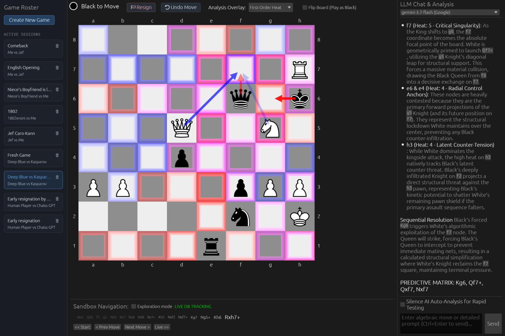
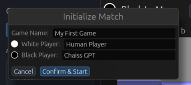
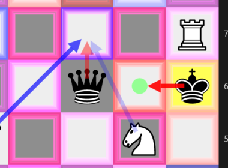
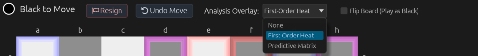
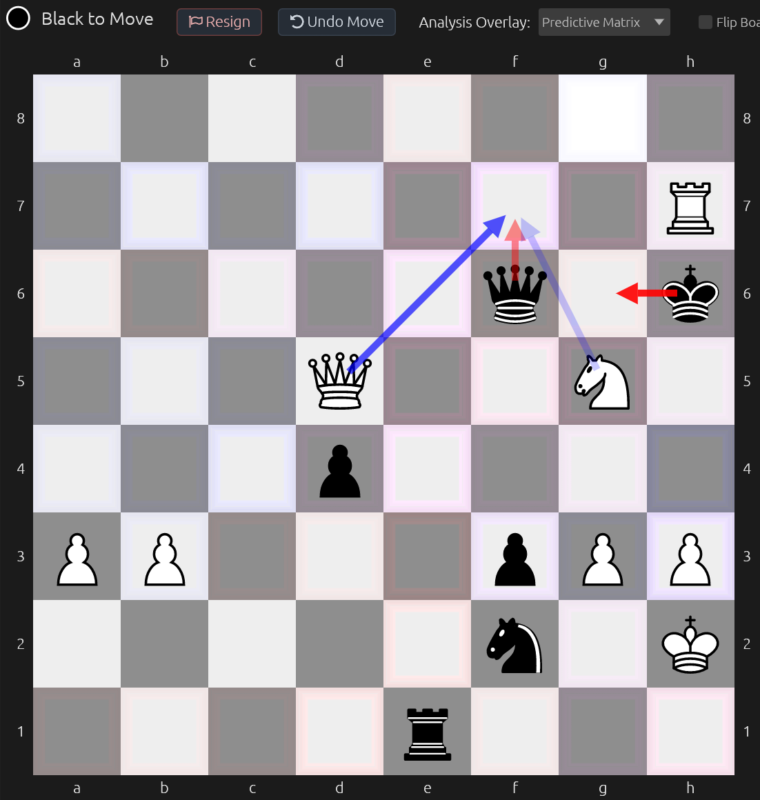
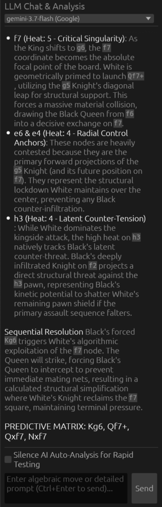
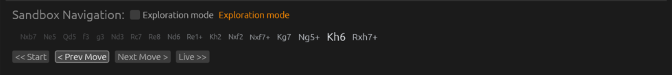

# Chaiss User Guide

Chaiss is an AI-assisted chess board. You play or replay a game on the
board, and a language model of your choice watches the position with you:
after every move it receives the exact board state and replies with an
analysis, ending in a short line of predicted plies that Chaiss draws as
arrows. This guide walks through the interface as it is in version 0.5.



The screenshot shows game 1 of the 1996 Deep Blue vs Kasparov match after
37.Rxh7+, the move on which Kasparov resigned. The red and blue arrows are
the model's predicted continuation; the coloured rings are the
first-order heat map.

## The window at a glance

Three panels, left to right:

- **Game Roster.** The `Create New Game` button and the list of saved
  sessions, newest first. The highlighted card is the game on the board.
- **The board.** A toolbar above it (turn indicator, `⚐ Resign`,
  `⟲ Undo Move`, the `Analysis Overlay` selector, `Flip Board`), the board
  itself, and the `Sandbox Navigation` strip below it for stepping through
  the game.
- **LLM Chat & Analysis.** The model selector, the conversation with the
  model, the `Silence AI Auto-Analysis` checkbox and the input box.

The panels can be resized by dragging their edges. Everything you do to a
live game is saved as it happens to the SQLite file next to the app
(`chaiss.db`, or the file named in your configuration), so you can quit at
any time and resume later.

## Creating a game



1. Click **`Create New Game`** in the Game Roster.
2. In the **Initialize Match** dialog, fill in the game name and the names
   of the White and Black players. The defaults are `My First Game`,
   `Human Player` and `Chaiss GPT`; the dialog remembers what you typed last
   time.
3. Click **`Confirm & Start`** (or `Cancel`). The new game appears at the top
   of the roster as a card showing its name and `White vs Black`, and the
   board resets to the starting position.

Clicking a card resumes that game: its moves, its chat history, its board
orientation and the model it last used. On launch, Chaiss resumes the game
at the top of the roster. The trash icon on a card deletes the game at
once, together with its moves and chat; there is no confirmation step.

## Loading a game from PGN

1. Start a new game, so the moves are applied from the starting position.
   A pasted PGN is played out on top of whatever position is on the board.
2. Paste the PGN text into the chat input box on the right. Chaiss treats
   the text as PGN when it starts with `[` or contains a move number such
   as `1.` or a result such as `1-0`. Tag lines in brackets, move numbers,
   `!`/`?` annotations and the result are ignored.
3. Press **Ctrl+Enter** (Cmd+Enter on macOS) or click **`Send`**. Plain
   Enter only adds a line to the box.

The moves are applied one by one and saved to the game. Chaiss stops at the
first move it cannot play, so a truncated board usually means a typo in the
PGN at that point. Unless auto-analysis is silenced, the model is then asked
to assess the resulting position, which is how the screenshot above was
produced.

## Making moves

### With the mouse



- Click one of the pieces of the side to move. The square turns yellow and
  every legal destination shows a translucent green dot. In the screenshot
  Black is in check, so the king's only legal move is to g6.
- Click a dot to make the move. Clicking anywhere else deselects; clicking
  another of your pieces selects that one instead.
- A pawn reaching the last rank promotes to a queen.

### By typing

Type a single move in standard algebraic notation into the chat input, for
example `e4`, `Nf3`, `O-O` or `Bxf7+`, and press **Ctrl+Enter** or click
`Send`. The move is played and saved like a mouse move. Typing a result
ends the game instead: `1-0`, `0-1`, `white resigned`, `black resigned`,
`white wins` or `black wins`.

### After a move

Each live move is saved immediately and, unless auto-analysis is silenced,
sent to the model for comment. The toolbar offers:

- **`⚐ Resign`** ends the game as a loss for the side to move.
- **`⟲ Undo Move`** removes the last saved move from the game and reloads it.
  It is only shown when there is a move to undo and the model is not busy.
- **`Flip Board (Play as Black)`** turns the board around. The choice is
  remembered per game.

When a game ends by checkmate, stalemate or resignation, the board dims and
shows the result; the pieces can no longer be moved.

## Analysis overlays



The `Analysis Overlay` selector in the toolbar has three settings:

- **None.** The plain board.
- **First-Order Heat** (the default). Each square gets coloured rings for
  the pieces that attack it right now: blue for White, red for Black, purple
  where both do. More attackers make the rings stronger, up to three.
- **Predictive Matrix.** The same rings, but summed over every legal reply
  of the side to move, so the squares that matter one move ahead light up.



The arrows on the board are separate from the overlay. They come from the
model, see below, and are drawn in all three settings.

## Chatting with the model



**Choosing a model.** When more than one provider is configured, a
dropdown at the top of the chat pane lists every available model as
`model (Provider)`, for example `gemini-3.8-flash (Google)` or
`gpt-6-astra (OpenAI)`. The model used for a game's last request is
remembered and restored when you resume that game. Configuration lives in
`.env` or `.chaiss.cola`; see the README.

**What the model sees.** With every request Chaiss sends the FEN, an ASCII
diagram of the board, the numbered move list, the whole chat history of the
game, and the four hottest squares from the predictive matrix. That is why
it can reason about the actual position rather than a half-remembered one.

**Automatic analysis.** After each live move or PGN load, Chaiss asks the
model to assess the position. The request appears in the chat as a 👤 User
message and the reply streams in as 🤖 Agent. Tick **`Silence AI
Auto-Analysis for Rapid Testing`** to switch this off while you set up a
position; your own questions are still sent.

**Asking your own questions.** Type anything that is not a move or a PGN
into the input box and press Ctrl+Enter: "What are Black's weaknesses?",
"Is the knight sacrifice sound?".

**The predictive matrix line.** Every reply ends with a line such as
`PREDICTIVE MATRIX: Kg6, Qf7+, Qxf7, Nxf7`, the model's expected
continuation. Chaiss plays those plies out silently and draws them as
arrows on the board, blue for White and red for Black, fading with depth.
The arrows are shown at the live position only and are cleared by your
next mouse move. If a reply arrives without that line, Chaiss asks again
up to three times before showing it.

**Errors.** Problems with the provider, such as a missing API key, a
rejected key, a rate limit or an unreachable backend, appear in the chat
as a ⚠️ System message with the cause; the details go to the terminal.

## Exploring lines without touching the game



The `Sandbox Navigation` strip under the board steps through the game:
**`<< Start`**, **`< Prev Move`**, **`Next Move >`** and **`Live >>`**. The
move list above the buttons highlights the current ply.

As soon as you step back from the latest position, the status changes from
green **LIVE DB TRACKING** to orange **Exploration mode**, and the same
happens when you tick the `Exploration mode` checkbox. In this mode:

- Mouse moves are played on the board as a what-if branch. They are not
  saved, not sent to the model, and show as `···` in the move list.
- Making a move while you are behind the latest position discards the
  moves after it in the branch; the saved game is untouched.
- The model's arrows are hidden until you return to the live position.
- **`Live >>`**, or unticking the checkbox, drops the branch and returns to
  the saved game.

One thing to know: a move typed into the chat box is always played on the
live game and saved, whatever the navigation state. Use the mouse for
experiments.

## From the command line

```
chaiss                           open the board (reads .env, .chaiss.cola and chaiss.db from the current directory)
chaiss --install-desktop-entry   Linux: install a launcher and icon so the window shows the Chaiss logo on Wayland
chaiss --version
chaiss --help
```

Configuration, the model providers, the database location and the
desktop-entry details are covered in the [README](../README.md).
